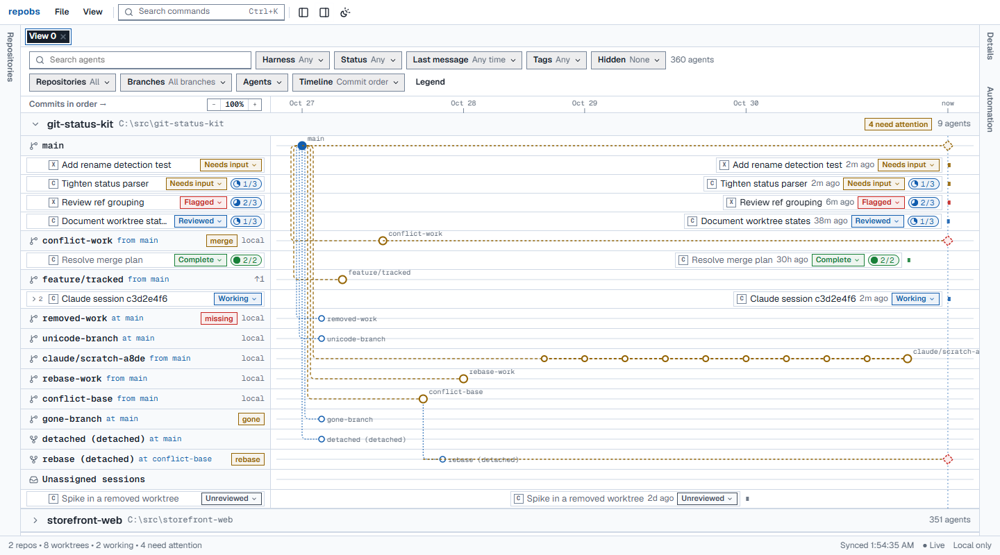

# repobs — observe your Git worktrees and coding agents, locally.

repobs is a local dashboard for developers who run many coding agents across Git worktrees and branches. It shows each repository's branches on one timeline with the Claude Code and Codex agents that worked on them, so you can see what each agent did, which ones are waiting for you, and what you still need to review.

It only reads. It never changes your repositories or agent files, needs no API keys, and sends nothing off your machine.



*Synthetic demo data: one repository's branches on the timeline, with each agent's status, review state and checklist pill.*

## Quick start (Windows)

You need Node.js 24 LTS (24.11+) and Git for Windows.

1. Download `repobs-<version>.zip` from the [latest release](https://github.com/Chengxuan-Li/repobs/releases/latest) and unzip it anywhere.
2. In the unzipped folder, run `npm start`. repobs starts on `127.0.0.1` and opens your browser.
3. Click **Add repositories** and tick the repositories repobs found in your agent sessions, or add a path such as `C:\src\my-project`.

Stop it with **Ctrl+C**. `npm run open` opens a new browser link to a running repobs.

**Upgrading:** unzip the new release and start it; your data stays in `%LOCALAPPDATA%\repobs`. When a version changes the database (0.3.0 does), it first saves a backup next to it, and older versions cannot open the updated database. See the [changelog](CHANGELOG.md).

**From source:**

```powershell
git clone https://github.com/Chengxuan-Li/repobs.git
cd repobs
npm ci
npm run build
npm start
```

## What you get

**See your repositories**

- Branches, worktrees and commits of every registered repository on one shared timeline: forks and merges, unpushed commits, uncommitted changes, detached HEADs, missing worktrees, and merges or rebases in progress.
- Commit order or calendar time, zoom and drag to pan; runs of quiet commits fold into groups.

**Follow your agents**

- Claude Code sessions (terminal or Claude desktop app) and Codex sessions, found in their local files: including sessions started outside repobs, several per worktree, and the sub-agents they spawned.
- Each agent's status with its evidence and confidence. Missing data shows as *Unknown*, never as idle.
- Optionally, a short redacted excerpt of the agent's latest message and the plan it keeps with its planning tool.

**Review them**

- Review states (including *Flagged* and *Outdated*), tags, alias and notes.
- Checklists in two parts: first the agent's own plan, synced as it works, then your items. You can tick or untick the agent's steps by your own judgement; nothing goes back to the agent.
- Automation rules, for example *idle for 7 days → Outdated*. Rules can set the review state, tags, alias, note and checklist items.

**Organise the view**

- Several named views, each with its own filters, hidden agents and repositories; dockable panels and a command palette.
- Export and import your annotations and views as JSON.
- Live updates as Git or agent files change.
- Optional, off by default: a read-only GitHub pull request overlay through the GitHub CLI.

## Privacy

- **Nothing leaves your machine.** repobs listens on `127.0.0.1` only, has no telemetry, and makes no network requests unless you turn on the pull request overlay.
- **Nothing is written to your repositories or agent files.** Git is used only through an allowlist of read-only commands, never through a shell.
- **Agent content stays in memory.** From session files repobs reads structural metadata. Message excerpts and plan steps are optional, held in memory only and never saved. Your own notes, tags, checklists and rules are stored in `%LOCALAPPDATA%\repobs`.
- **Only your browser gets in.** It pairs with the local service through a one-time link; every request is checked (session cookie, Host and Origin, CSRF token) under a strict content security policy.

Details: [privacy and security](docs/privacy-security.md) and [SECURITY.md](SECURITY.md).

## Supported

- **Windows 11 first.** macOS and Linux are expected to work, and the tests also run on Ubuntu, but they are not the main target.
- **Claude Code 2.1.x and Codex 0.165** session files were checked in October 2026. Agent plans were observed with the Claude desktop app's task list in November 2026; Claude Code `TodoWrite` and Codex plans follow their published formats. A format repobs does not recognise shows as *Unknown* instead of failing.
- **Version 0.x.** Features and storage can still change between versions; the changelog says how.

## Documentation

The documentation site is at **[chengxuan-li.github.io/repobs](https://chengxuan-li.github.io/repobs/)**: [getting started](https://chengxuan-li.github.io/repobs/getting-started/), [user guide](https://chengxuan-li.github.io/repobs/user-guide/), [status semantics](https://chengxuan-li.github.io/repobs/status-semantics/), [integrations](https://chengxuan-li.github.io/repobs/integrations/) and [limitations](https://chengxuan-li.github.io/repobs/limitations/).

## Development

- `npm run dev`: the server from sources with watch, and the Vite dev UI on `http://127.0.0.1:5173`.
- `node scripts/demo.ts <empty folder>`: builds synthetic repositories and agent sessions, and prints the environment to start repobs on them.
- `npm run typecheck`, `npm run lint`, `npm test`, `npm run test:integration`, `npm run test:e2e` (after `npm run build`).
- Documentation: `python -m pip install -r requirements-docs.txt`, then `python -m mkdocs serve`.

See [architecture](docs/architecture.md), the [HTTP API](docs/api.md), [testing](docs/development/testing.md) and the [progress log](docs/development/handoff-status.md).

## License

MIT — see [LICENSE](LICENSE).
