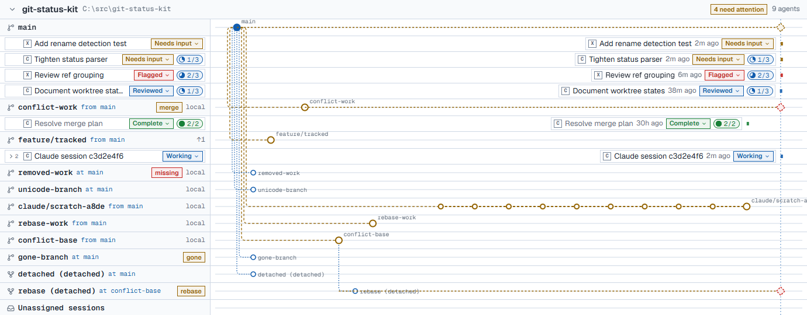
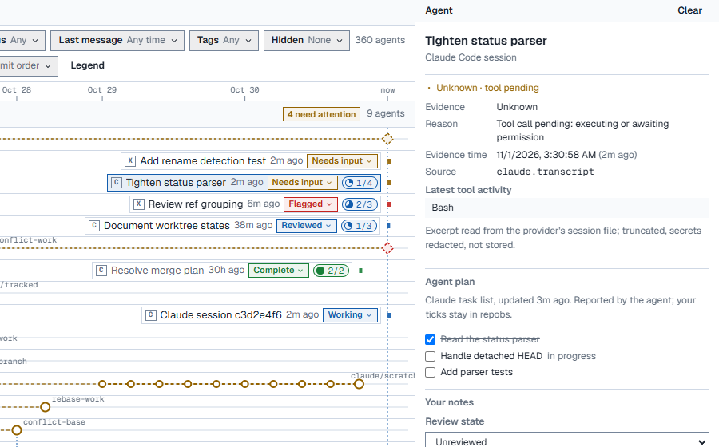
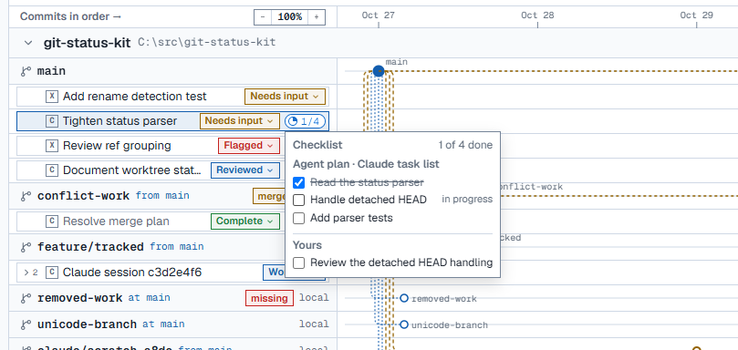

---
hide:
  - navigation
  - toc
---

# repobs

*every worktree and coding agent, on one local timeline.*
{ .ui-tagline }

A read-only dashboard for developers who run many coding agents across Git worktrees and branches: each repository's branches on one timeline, with the Claude Code and Codex agents that worked on them, what they are doing now, and what you still need to review.

[Download](https://github.com/Chengxuan-Li/repobs/releases/latest){ .md-button .md-button--primary } [Get started](getting-started.md){ .md-button }

<video class="ui-film" controls preload="none" playsinline width="1920" height="1080" poster="assets/repobs-film-poster.jpg" aria-label="The repobs film, 25 seconds, with sound">
  <source src="assets/repobs-film.mp4" type="video/mp4">
  <a href="assets/repobs-film.mp4">Download the repobs film (MP4, 25 seconds)</a>
</video>

*A 25-second film, animated: the repositories, branches and agents in it are invented. The pictures below are the real application on demo data.*

## Features { #features .ui-strip data-index="01" data-note="What repobs shows" }

### See every branch { .ui-feature-title }

{ .ui-feature__media }

*Your repositories, branches and worktrees on one timeline.*
{ .ui-feature__lead }

- Forks, merges, unpushed commits and uncommitted changes.
- Scratch branches, detached HEADs and missing worktrees.
- Commit order or calendar time; zoom, pan and fold quiet history.

### Follow every agent { .ui-feature-title }

{ .ui-feature__media }

*Each Claude Code and Codex agent, on the branch it worked on.*
{ .ui-feature__lead }

- Its status with the evidence behind it, and *Unknown* when there is none.
- The sub-agents it spawned and its latest message.
- The plan it keeps with its planning tool, step by step.

### Review on your terms { .ui-feature-title }

{ .ui-feature__media }

*Your notes on the agents, kept apart from their work.*
{ .ui-feature__lead }

- Review states, tags, aliases and notes.
- Checklists: the agent's plan first, then your own items.
- Automation rules, for example *idle for 7 days → Outdated*.

## Local and read-only { .ui-strip data-index="02" data-note="By design" }

*Nothing leaves your machine, and nothing is written to your repositories.*
{ .ui-feature__lead }

- repobs listens on `127.0.0.1` only, has no telemetry and calls no model API.
- Git is used only through read-only commands; agent files and configuration are never edited.
- Message excerpts and plan steps stay in memory; your notes live under `%LOCALAPPDATA%\repobs`.

See [Privacy & security](privacy-security.md).

## Support { .ui-strip data-index="03" data-note="Platforms and agents" }

| | Status |
| --- | --- |
| Windows 11, Git for Windows | Primary platform, tested |
| macOS / Linux | Expected to work (CI runs the suite on Ubuntu); not the primary target |
| Claude Code, terminal and desktop app (2.1.x session files) | Supported, verified against local data |
| OpenAI Codex CLI and desktop (0.165 rollout files) | Supported, verified against local data |
| Node.js | 24 LTS (24.11 or newer) |
| GitHub pull requests | Optional, read-only, off by default (GitHub CLI) |

## Documentation { .ui-strip data-index="04" data-note="Two parts" }

-   [User guide](guide/index.md)

    For people who use repobs: installing it, the dashboard and its agent cards, review states, notes and checklists, automation, what each status means, what is read from Claude Code and Codex, and what stays private.

    [Open the user guide](guide/index.md){ .md-button }

-   [Developer](developer/index.md)

    For people who change repobs itself: the architecture, the HTTP API, testing, the progress log and the architecture decision records.

    [Open the developer documentation](developer/index.md){ .md-button }

*See your agents on one timeline.*
{ .ui-tagline }

[Download](https://github.com/Chengxuan-Li/repobs/releases/latest){ .md-button .md-button--primary } [Get started](getting-started.md){ .md-button }

